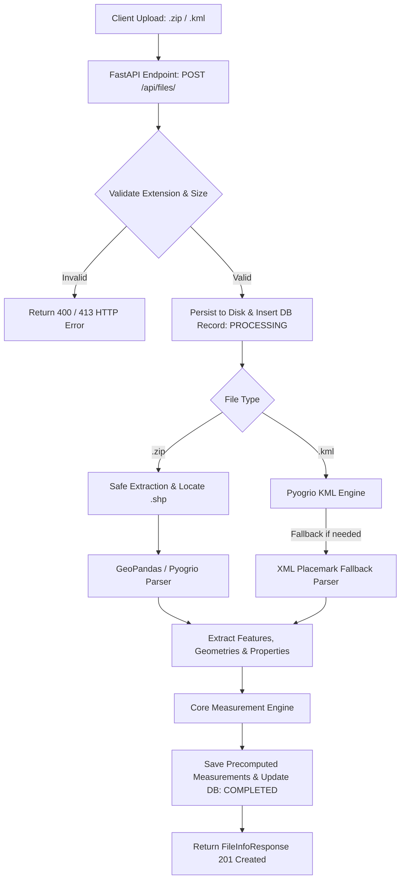
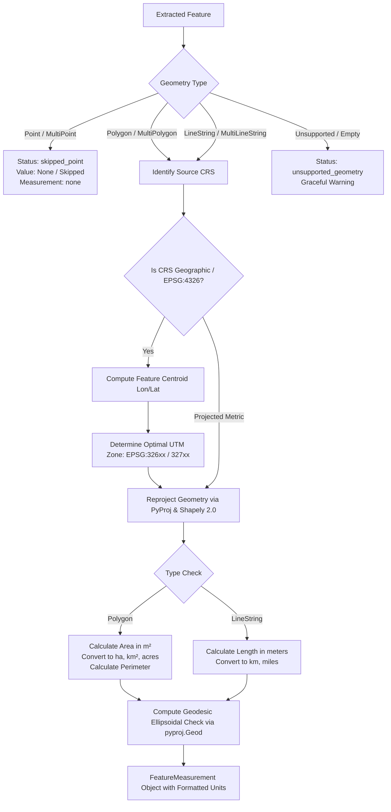

# 🌍 Geospatial File Measurement API

A production-grade Python backend service built with **FastAPI**, **GeoPandas**, **Shapely 2.0**, and **PyProj** that accepts geospatial files (**ESRI Shapefile `.zip`** and **KML `.kml`**), parses their features, transforms coordinates from geographic to optimal projected coordinate reference systems (CRS), and calculates accurate metric measurements (polygon area and linestring length).

Includes an interactive **Web Dashboard & Visualizer**, **OpenAPI / Swagger documentation**, **SQLite persistence**, and a **Pytest test suite**.

---

## 📋 Table of Contents
1. [Features](#-features)
2. [Architecture](#-architecture)
   - [Application Structure](#application-structure)
   - [File Processing Flow](#file-processing-flow)
   - [Measurement Calculation Flow](#measurement-calculation-flow)
   - [CRS Handling & Projection Strategy](#crs-handling--projection-strategy)
3. [Design Decisions & Alternatives](#-design-decisions--alternatives)
4. [Quick Start & Setup](#-quick-start--setup)
   - [Local Environment (Python 3.10+)](#local-environment-python-310)
   - [Docker & Docker Compose](#docker--docker-compose)
5. [API Reference & Examples](#-api-reference--examples)
   - [1. Upload Geospatial File](#1-upload-geospatial-file)
   - [2. Get File Information](#2-get-file-information)
   - [3. Get Feature Measurements](#3-get-feature-measurements)
   - [4. Get GeoJSON Features](#4-get-geojson-features)
   - [5. List Uploaded Files](#5-list-uploaded-files)
   - [6. Delete File](#6-delete-file)
   - [7. Health Check](#7-health-check)
6. [Testing](#-testing)
7. [Learnings & Future Scope](#-learnings--future-scope)

---

## ✨ Features

- **Multi-Format Ingestion**: Supports `.zip` containing Shapefiles (`.shp`, `.shx`, `.dbf`, `.prj`) and `.kml` files.
- **Accurate Metric Calculations**:
  - **Polygons / MultiPolygons**: Area in square meters ($m^2$), hectares ($ha$), square kilometers ($km^2$), acres, plus boundary perimeters.
  - **LineStrings / MultiLineStrings**: Length in meters ($m$), kilometers ($km$), and miles.
  - **Points / MultiPoints**: Gracefully skipped (`status: skipped_point`, `value: null`) without crashing.
  - **Unsupported Geometries**: Handled gracefully with descriptive error status.
- **Automated CRS Reprojection**:
  - Automatically identifies whether coordinates are geographic (e.g. `EPSG:4326`, degrees) or distorted (e.g. Web Mercator `EPSG:3857`).
  - Automatically derives the optimal **UTM Zone** projected coordinate system (in meters) based on the feature's centroid longitude/latitude.
  - Computes secondary ellipsoidal geodesic measurements with `pyproj.Geod` (WGS84 ellipsoid).
- **Interactive Web Dashboard**:
  - Drag-and-drop file upload.
  - Summary metric cards (total area, total length, feature breakdown).
  - Leaflet map visualization with feature inspection popups.
  - Feature search and geometry type filter.
  - Export measurements to JSON.
- **Full GeoJSON Export**: Endpoints to stream standard GeoJSON `FeatureCollection` for integration into QGIS, Mapbox, or Leaflet.
- **Robust Security & Resilience**: Zip-slip path traversal protection, file size enforcement (50MB cap), and sanitized Pandas `NaT`/`NaN` attribute serialization.

---

## 🏗 Architecture

### Application Structure

```text
geospatial-api/
├── app/
│   ├── __init__.py
│   ├── main.py                # FastAPI app creation, CORS, static mounting, error handling
│   ├── config.py              # Configuration settings, paths, limits
│   ├── api/
│   │   ├── __init__.py
│   │   └── endpoints.py       # API endpoints (Upload, Info, Measurements, GeoJSON, Health)
│   ├── core/
│   │   ├── __init__.py
│   │   ├── crs.py             # CRS inspection, Auto-UTM selection, Shapely 2.0 reprojection
│   │   ├── measurements.py    # Metric area/length calculation, units, geodesic comparison
│   │   └── parsers.py         # Shapefile (.zip) & KML extraction with fallback XML parser
│   ├── models/
│   │   ├── __init__.py
│   │   ├── schemas.py         # Pydantic v2 schemas for request, response, and metadata
│   │   └── database.py        # SQLite persistence layer for file tracking & measurements
│   └── static/
│       ├── index.html         # Web visualizer dashboard
│       ├── style.css          # Modern dark/glassmorphic interface styles
│       └── app.js             # Leaflet map, drag-drop upload, dynamic tables
├── sample_data/               # Pre-generated sample datasets
│   ├── sample_survey.kml
│   ├── sample_parcels_shapefile.zip
│   ├── sample_lines_shapefile.zip
│   └── create_samples.py      # Sample data generation script
├── tests/                     # 17 automated tests
│   ├── test_api.py            # End-to-end API route tests
│   ├── test_crs.py            # CRS projection & UTM calculation tests
│   ├── test_measurements.py   # Polygon area, line length, point skip tests
│   └── test_parsers.py        # Shapefile and KML parser tests
├── Dockerfile                 # Container image specification with GDAL/GEOS
├── docker-compose.yml         # Container orchestration
├── requirements.txt           # Pinned Python package dependencies
├── .gitignore
└── README.md
```

---

### File Processing Flow



---

### Measurement Calculation Flow



---

### CRS Handling & Projection Strategy

Geographic coordinates (such as **EPSG:4326** WGS84) are represented in angular units (**degrees**). Directly executing Cartesian geometric operations on degrees produces mathematically invalid numbers:
- One degree of latitude is $\approx 111\text{ km}$, but one degree of longitude varies from $111\text{ km}$ at the equator to $0\text{ km}$ at the poles ($\approx 111 \times \cos(\text{latitude})\text{ km}$).
- Directly computing $(x_2 - x_1)^2 + (y_2 - y_1)^2$ yields square degrees ($\text{deg}^2$), which is meaningless for physical land measurement.

#### Reprojection Strategy:
1. **Source CRS Identification**:
   - For Shapefiles: Extracted directly from the embedded `.prj` file (ESRI WKT format). If the `.prj` file is missing, defaults to `EPSG:4326` with an explicit notice (`EPSG:4326 (assumed, .prj missing)`).
   - For KML: As defined by the Open Geospatial Consortium (OGC) KML 2.2 standard, coordinates are always WGS84 (`EPSG:4326`).
2. **Auto-UTM Zone Derivation**:
   - Given the centroid $(\lambda, \phi)$ in WGS84 coordinates:
     $$\text{Zone} = \left\lfloor \frac{\lambda + 180}{6} \right\rfloor + 1$$
   - Hemisphere assignment:
     $$\text{EPSG} = 32600 + \text{Zone} \quad (\text{for } \phi \ge 0, \text{ Northern Hemisphere})$$
     $$\text{EPSG} = 32700 + \text{Zone} \quad (\text{for } \phi < 0, \text{ Southern Hemisphere})$$
   - Polar Latitudes: For extreme polar regions ($\phi > 84^\circ\text{N}$ or $\phi < -80^\circ\text{S}$), falls back to Universal Polar Stereographic (UPS North: `EPSG:32661`, UPS South: `EPSG:32761`).
3. **Web Mercator (`EPSG:3857`) Handling**:
   - Web Mercator is projected, but its area distortion factor is $\frac{1}{\cos^2(\phi)}$ (e.g. Greenland appears the size of Africa). The system identifies `EPSG:3857` and reprojects to the local UTM zone to yield true ground measurements.
4. **Geodesic Cross-Verification**:
   - Alongside UTM planar projection, the service computes geodesic metrics using `pyproj.Geod(ellps="WGS84")` using Karney’s algorithms for ellipsoidal shortest paths and polygon areas.

---

## 💡 Design Decisions & Alternatives

| Decision | Selected Option | Alternatives Considered | Rationale |
|---|---|---|---|
| **Backend Framework** | **FastAPI** | Django / Django REST Framework | FastAPI offers high asynchronous performance, native type safety via Pydantic v2, automatic OpenAPI/Swagger interactive documentation, and low overhead. |
| **Geospatial Processing Engine** | **GeoPandas + Shapely 2.0 + PyProj** | Custom GDAL C-bindings / GeoDjango | Shapely 2.0 provides vectorized C/GEOS execution. PyProj interfaces with the latest PROJ 9 database for geodetic transforms. |
| **Shapefile Parser** | **Zip extraction with zip-slip check + GeoPandas** | Manual pyshp parsing | GeoPandas parses attribute tables, `.prj` files, and geometry encodings consistently. Path traversal checks protect against malicious archives. |
| **KML Parser** | **Dual strategy: Pyogrio + ElementTree Placemark fallback** | fastkml only | Standard KML files vary in XML namespaces and structure. Pyogrio handles standard KML layers; the fallback parser gracefully handles arbitrary placemarks. |
| **Projection Strategy** | **Automated Local UTM Zone per geometry** | World Equal Earth (EPSG:6933) or Web Mercator | Local UTM minimizes conformal distortion to under 0.04% for local surveying and parcels. |
| **Data Storage** | **SQLite + File Repository** | PostgreSQL / PostGIS | SQLite is embedded, self-contained, requires zero external services to run locally or in CI, and is thread-safe. |
| **Frontend** | **Vanilla JS + Leaflet + Modern CSS** | React / Next.js bundle | Zero build step (`npm run build`), instant zero-latency loading, and works directly out of the box with the FastAPI server. |

---

## 🚀 Quick Start & Setup

### Local Environment (Python 3.10+)

#### 1. Clone the repository
```bash
git clone https://github.com/<your-username>/geospatial-measurement-api.git
cd geospatial-measurement-api
```

#### 2. Create and activate a virtual environment
**On Linux / macOS:**
```bash
python3 -m venv .venv
source .venv/bin/activate
```
**On Windows (PowerShell):**
```powershell
python -m venv .venv
.\.venv\Scripts\Activate.ps1
```

#### 3. Install dependencies
```bash
pip install --upgrade pip
pip install -r requirements.txt
```

#### 4. (Optional) Generate sample geospatial data
```bash
python sample_data/create_samples.py
```

#### 5. Run the server
```bash
uvicorn app.main:app --host 0.0.0.0 --port 8000 --reload
```

- **Web Dashboard**: Open [http://localhost:8000/](http://localhost:8000/)
- **Swagger Interactive API Docs**: Open [http://localhost:8000/docs](http://localhost:8000/docs)
- **ReDoc API Documentation**: Open [http://localhost:8000/redoc](http://localhost:8000/redoc)

---

### Docker & Docker Compose

Run the entire service in an isolated container without needing local GDAL/GEOS installed:

```bash
docker compose up --build
```
Access the application at [http://localhost:8000/](http://localhost:8000/).

---

## 📡 API Reference & Examples

### 1. Upload Geospatial File
Uploads and processes a `.zip` (Shapefile) or `.kml` file.

- **Endpoint**: `POST /api/files/`
- **Content-Type**: `multipart/form-data`
- **Curl Example**:
  ```bash
  curl -X POST "http://localhost:8000/api/files/" \
       -F "file=@sample_data/sample_survey.kml"
  ```
- **Example Response (`201 Created`)**:
  ```json
  {
    "id": "c1f7b82e-9d21-4f8e-8a21-93c4e470d03b",
    "filename": "sample_survey.kml",
    "file_type": "kml",
    "file_size_bytes": 2740,
    "feature_count": 6,
    "crs": "EPSG:4326",
    "status": "COMPLETED",
    "geometry_summary": {
      "Polygon": 2,
      "LineString": 2,
      "Point": 2
    },
    "created_at": "2026-10-07T10:05:00.000000Z",
    "error_message": null
  }
  ```

---

### 2. Get File Information
Retrieves metadata and processing state for an uploaded file.

- **Endpoint**: `GET /api/files/{id}/`
- **Curl Example**:
  ```bash
  curl -X GET "http://localhost:8000/api/files/c1f7b82e-9d21-4f8e-8a21-93c4e470d03b/"
  ```
- **Example Response (`200 OK`)**:
  ```json
  {
    "id": "c1f7b82e-9d21-4f8e-8a21-93c4e470d03b",
    "filename": "sample_survey.kml",
    "file_type": "kml",
    "file_size_bytes": 2740,
    "feature_count": 6,
    "crs": "EPSG:4326",
    "status": "COMPLETED",
    "geometry_summary": {
      "Polygon": 2,
      "LineString": 2,
      "Point": 2
    },
    "created_at": "2026-10-07T10:05:00.000000Z",
    "error_message": null
  }
  ```

---

### 3. Get Feature Measurements
Returns feature-by-feature measurements and dataset aggregate totals.

- **Endpoint**: `GET /api/files/{id}/measurements/`
- **Query Parameters**:
  - `include_geometry`: `boolean` (default: `false`). Set to `true` to include full GeoJSON geometry payloads.
- **Curl Example**:
  ```bash
  curl -X GET "http://localhost:8000/api/files/c1f7b82e-9d21-4f8e-8a21-93c4e470d03b/measurements/?include_geometry=false"
  ```
- **Example Response (`200 OK`)**:
  ```json
  {
    "file_id": "c1f7b82e-9d21-4f8e-8a21-93c4e470d03b",
    "filename": "sample_survey.kml",
    "source_crs": "EPSG:4326",
    "total_features": 6,
    "summary": {
      "total_features": 6,
      "polygon_count": 2,
      "linestring_count": 2,
      "point_count": 2,
      "unsupported_count": 0,
      "total_area_sq_meters": 1391512.28,
      "total_area_hectares": 139.1512,
      "total_area_sq_km": 1.391512,
      "total_length_meters": 6128.45,
      "total_length_km": 6.1285
    },
    "features": [
      {
        "feature_id": 0,
        "geometry_type": "Polygon",
        "measurement_type": "area",
        "value": 1308381.1618,
        "unit": "square_meters",
        "formatted_value": "1,308,381.16 m² (130.8381 ha)",
        "projected_crs": "EPSG:32618",
        "additional_units": {
          "hectares": 130.8381,
          "square_kilometers": 1.308381,
          "acres": 323.3076,
          "perimeter_meters": 5192.42
        },
        "perimeter_or_length_meters": 5192.42,
        "geodesic_value": 1308412.3312,
        "status": "success",
        "message": null,
        "properties": {
          "Name": "Central Park Sector A",
          "Description": "Public recreation zone with grass lawn",
          "zone_type": "Recreation"
        },
        "geometry": null
      },
      {
        "feature_id": 2,
        "geometry_type": "LineString",
        "measurement_type": "length",
        "value": 3140.2311,
        "unit": "meters",
        "formatted_value": "3,140.23 m (3.140 km)",
        "projected_crs": "EPSG:32618",
        "additional_units": {
          "kilometers": 3.1402,
          "miles": 1.9512
        },
        "perimeter_or_length_meters": 3140.23,
        "geodesic_value": 3140.3121,
        "status": "success",
        "message": null,
        "properties": {
          "Name": "East River Greenway Path",
          "route_id": "RT-109"
        },
        "geometry": null
      },
      {
        "feature_id": 4,
        "geometry_type": "Point",
        "measurement_type": "none",
        "value": null,
        "unit": null,
        "formatted_value": "N/A (Point feature)",
        "projected_crs": null,
        "additional_units": null,
        "perimeter_or_length_meters": null,
        "geodesic_value": null,
        "status": "skipped_point",
        "message": "Measurement not required for Point geometries.",
        "properties": {
          "Name": "Geodetic Bench Mark #41",
          "elevation_m": "24.5"
        },
        "geometry": null
      }
    ]
  }
  ```

---

### 4. Get GeoJSON Features
Returns the dataset as a standard GeoJSON `FeatureCollection` with embedded measurement attributes (`_formatted_value`, `_projected_crs`, `_measurement_type`, `_measurement_value`).

- **Endpoint**: `GET /api/files/{id}/features/`
- **Curl Example**:
  ```bash
  curl -X GET "http://localhost:8000/api/files/c1f7b82e-9d21-4f8e-8a21-93c4e470d03b/features/"
  ```

---

### 5. List Uploaded Files
Returns a list of all uploaded files with pagination.

- **Endpoint**: `GET /api/files/?limit=50&offset=0`

---

### 6. Delete File
Removes an uploaded file, its cache, and all associated measurements.

- **Endpoint**: `DELETE /api/files/{id}/`

---

### 7. Health Check
Returns service health, driver availability, and library versions.

- **Endpoint**: `GET /api/health/`
- **Example Response**:
  ```json
  {
    "status": "healthy",
    "version": "1.0.0",
    "geospatial_backend": {
      "pyproj_version": "3.8.0",
      "shapely_version": "2.2.0",
      "pyogrio_version": "0.13.0",
      "kml_driver_available": true,
      "shapefile_driver_available": true
    },
    "supported_file_types": [
      ".zip (Shapefile)",
      ".kml (KML Document)"
    ]
  }
  ```

---

## 🧪 Testing

The test suite covers:
- **UTM zone selection**: Tests for Northern/Southern hemispheres, equator, and polar coordinates.
- **Reprojection accuracy**: Ensures metric units rather than tiny degree squared values.
- **Measurement calculations**: Area for Polygons & MultiPolygons; Length for LineStrings & MultiLineStrings.
- **Edge cases**: Skipping Points without error, handling empty geometries, and graceful unsupported geometries.
- **Parser tests**: Unzipping Shapefiles with zip-slip validation and KML parsing.
- **API integration**: Upload, Info, Measurements, GeoJSON, List, Delete, and validation error status codes.

Run tests:
```bash
pytest -v
```

Output:
```text
tests/test_api.py::test_health_check_endpoint PASSED                     [  5%]
tests/test_api.py::test_upload_and_get_kml PASSED                        [ 11%]
tests/test_api.py::test_upload_and_get_shapefile_zip PASSED              [ 17%]
tests/test_api.py::test_list_files PASSED                                [ 23%]
tests/test_api.py::test_delete_file PASSED                               [ 29%]
tests/test_api.py::test_invalid_extension_upload PASSED                  [ 35%]
tests/test_crs.py::test_utm_epsg_determination PASSED                    [ 41%]
tests/test_crs.py::test_geometry_reprojection PASSED                     [ 47%]
tests/test_measurements.py::test_polygon_measurement PASSED              [ 52%]
tests/test_measurements.py::test_linestring_measurement PASSED           [ 58%]
tests/test_measurements.py::test_point_handling_no_crash PASSED          [ 64%]
tests/test_measurements.py::test_unsupported_or_empty_geometry_handling PASSED [ 70%]
tests/test_measurements.py::test_multipolygon_measurement PASSED         [ 76%]
tests/test_measurements.py::test_multilinestring_measurement PASSED      [ 82%]
tests/test_parsers.py::test_parse_sample_kml PASSED                      [ 88%]
tests/test_parsers.py::test_parse_sample_shapefile_zip PASSED            [ 94%]
tests/test_parsers.py::test_invalid_zip_without_shp PASSED               [100%]

======================== 17 passed in 2.6s ========================
```

---

## 📚 Learnings & Future Scope

### Key Learnings
1. **Coordinate System Realities**: Geographic coordinates ($EPSG:4326$) cannot be treated with planar Euclidean math. Transforming to a localized projected CRS (such as UTM) or employing geodesic ellipsoidal algorithms is critical for physically meaningful metrics.
2. **Handling Attribute Heterogeneity**: Geospatial tables read via GDAL or GeoPandas frequently contain missing values, non-standard timestamps, or specialized objects (such as `pd.NaT`, `np.nan`). Sanitizing attributes before database persistence and API JSON responses is essential to ensure zero runtime serialization errors.
3. **KML Specification Nuances**: KML documents encountered in practice vary widely. Implementing an OGC Pyogrio reader alongside an XML ElementTree fallback ensures reliable parsing across multiple KML structures.
4. **FastAPI vs. Django for Spatial Services**: While GeoDjango offers built-in ORM fields with PostGIS, FastAPI paired with lightweight Shapely 2.0 and PyProj provides faster startup times, automatic OpenAPI schemas, and simplified containerization without heavy external database dependencies.

### Future Scope
- **Asynchronous Processing with Celery / Redis**: For large geospatial datasets (e.g. Shapefiles exceeding 500,000 features or 1GB), offload parsing and reprojection to background worker tasks with WebSocket progress updates.
- **Additional Geospatial Formats**: Extend ingestion support to **GeoJSON**, **GeoPackage (`.gpkg`)**, **FlatGeobuf**, and **KMZ** (zipped KML).
- **Z-Coordinate & 3D Topographic Length**: Incorporate elevation coordinates ($Z$) or Digital Elevation Models (DEM) to calculate 3D surface area and true 3D slope distances.
- **Cloud Object Storage**: Add storage adapters for AWS S3, Google Cloud Storage, or Azure Blob Storage for scalable file handling.
- **Vector Tile Streaming**: Serve Mapbox Vector Tiles (MVT) for large datasets directly on the interactive map visualizer.

---

## 📄 License
MIT License. Built for production-quality geospatial processing.
